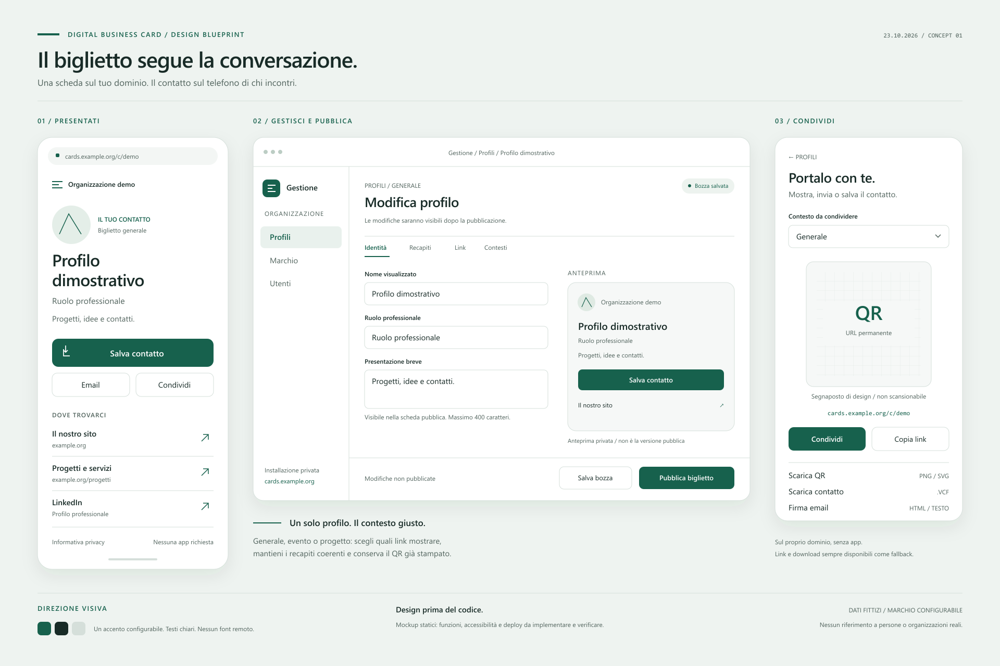

# Digital Business Card

Design e blueprint di un sistema di biglietti da visita digitali, indipendente dal marchio e installabile su infrastruttura propria.

**Stato: progettazione, 23 ottobre 2026.** L'applicazione non è implementata, avviabile o pronta per il deploy. I mockup sono immagini di progetto; il riquadro QR non è scansionabile. Le istruzioni operative descrivono l'installazione futura e non sono ancora validate su una VM.

## Risultato previsto

Una scheda pubblica per persona con recapiti, siti, LinkedIn e download vCard. Un collegamento permanente permette di aggiornare la scheda senza ristampare il QR. L'utente può mostrare il QR dal telefono, inviare il collegamento o condividere il file contatto.

Un'installazione ospita una sola organizzazione e più persone. Logo, colori, testi e dominio sono configurabili. Nessun riferimento personale o aziendale è incorporato nell'interfaccia o nei dati dimostrativi.

## Documenti

| Documento | Contenuto |
| --- | --- |
| [Prodotto e UX](docs/PRODUCT-UX.md) | Obiettivi, flussi, schermate, stati, design system e perimetro MVP |
| [Blueprint tecnico](docs/TECHNICAL-BLUEPRINT.md) | Architettura, dati, rotte, pubblicazione, QR, vCard e sicurezza |
| [Azure Windows](docs/AZURE-WINDOWS.md) | Topologia Apache/PHP/MySQL, procedura prevista, backup e rollback |
| [Piano di implementazione](docs/IMPLEMENTATION-PLAN.md) | Milestone, dipendenze, test e criteri di prontezza |
| [Decisione di licenza](LICENSE-DECISION.md) | Componenti, licenza, provenienza e verifiche prima della pubblicazione |

## Design

La tavola comprende scheda pubblica, editor con anteprima e modalità di condivisione. Il sorgente vettoriale modificabile è [overview.svg](docs/design/overview.svg).

## Scelte proposte

- PHP/Laravel con rendering server e JavaScript progressivo; MySQL 8.4 LTS; Apache 2.4 su Windows x64.
- Pagine pubbliche accessibili senza account e senza app; autenticazione per gestione e pubblicazione.
- Configurazione e file caricati separati dal codice pubblico; dipendenze distribuite localmente, senza CDN nel percorso pubblico.
- Nessun abbonamento a generatori QR e nessuna raccolta di contatti dei visitatori nell'MVP.
- Nessuna pipeline, pubblicazione, infrastruttura cloud o risorsa a pagamento viene attivata in questa fase.

Le versioni precise, le estensioni PHP e le dipendenze verranno bloccate e verificate alla prima milestone di implementazione.

## Licenza e sostegno

Documenti e disegni originali: [Apache License 2.0](LICENSE). Le dipendenze future conserveranno le proprie licenze. Vedere [NOTICE](NOTICE) e [LICENSE-DECISION.md](LICENSE-DECISION.md).

I canali di sostegno configurati dal manutentore sono predisposti in [.github/FUNDING.yml](.github/FUNDING.yml), su richiesta dell'utente. Non fanno parte del marchio o dei dati dell'applicazione.

La creazione della repository pubblica è rinviata alla fase di implementazione e alla verifica degli artefatti di pubblicazione. Una repository pubblica consente già visione e fork nei termini della piattaforma.
