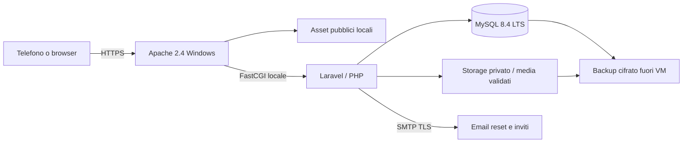

# Blueprint tecnico

Contratto proposto per l'implementazione. Nessun endpoint, tabella o comando applicativo esiste ancora.

## 1. Architettura e motivazione

Monolite Laravel/PHP con template Blade server-rendered e JavaScript progressivo. Apache serve gli asset e inoltra PHP a FastCGI; MySQL conserva dati e sessioni. Un dominio e una organizzazione per installazione. Lo stesso codice può essere installato da organizzazioni diverse senza modifiche ai sorgenti.

Questa scelta limita i processi persistenti da gestire su Windows e si integra con Apache e MySQL. Una SPA React più API separata aumenterebbe build, autenticazione e gestione del deploy senza un vantaggio necessario per l'MVP. Multi-tenancy e database separati per cliente richiederebbero un progetto distinto.



Baseline proposta: Windows Server x64 supportato, Apache 2.4 aggiornato, PHP 8.4 NTS x64 e una major Laravel mantenuta compatibile. Alla milestone 1 scegliere la major corrente verificando matrice ufficiale PHP/Laravel, durata supporto e librerie; bloccare tutte le versioni nei manifest/lock. MySQL 8.4 LTS. Nessun requisito Node in produzione se gli asset sono compilati nel pacchetto di release.

## 2. Moduli e confini

| Modulo | Responsabilità |
| --- | --- |
| Identity & access | Login, password, TOTP admin, recupero, sessioni, assegnazioni e policy |
| Profiles | Dati base, campi pubblicabili, link, validazione e versioni bozza |
| Cards | Contesti, ID permanenti, stato e snapshot pubblicato |
| Publishing | Validazione completa, generazione artefatti, scambio atomico della revisione |
| Contact export | vCard da campi autorizzati della revisione pubblicata |
| QR export | URL permanente, contrasto, dimensioni e margini di scansione |
| Sharing | Copia/share, bozza email e firma esportabile |
| Branding | Impostazioni organizzazione, colori e media |
| Audit | Accessi amministrativi rilevanti e modifiche, con minimizzazione dei dati |

I controller restano sottili; policy server-side per ogni modifica. Servizi separati per pubblicazione, vCard e QR. Test dei contratti indipendenti dal template grafico. Niente HTML libero o codice personalizzato nei campi del profilo.

## 3. Modello dati logico

Tutti gli orari sono UTC; UI localizzata. Chiavi interne non pubbliche, ID pubblici casuali CSPRNG da almeno 128 bit. MySQL InnoDB, transazioni, `utf8mb4`, vincoli e indici unici. Schema e nomi sono da tradurre in migration, non SQL già applicabile.

| Entità | Campi principali e vincoli |
| --- | --- |
| organization_settings | singleton; nome, accento, logo_media_id, locale, public_base_url e versione |
| users | email normalizzata unica, password_hash, role admin/editor, status, TOTP cifrato e recovery hash |
| profile_user | profile_id + user_id unici; assegnazione esplicita |
| profiles | id, public_id unico, nome, cognome/display_name, ruolo, bio, email, phone_e164, company, photo_media_id, draft_version, status |
| profile_links | profile_id, titolo, URL HTTPS validato, tipo, posizione; massimo 12 per profilo nell'MVP |
| cards | profile_id, public_id unico, nome contesto, campo pubblico policy, link_selection, draft_version, published_revision_id, status |
| card_revisions | card_id, numero revisione, snapshot JSON normalizzato, vcard path/hash, QR path/hash, actor_id, published_at |
| media | random_name, mime, byte_size, dimensions, checksum, storage_path, owner_id; nessun path client |
| audit_events | actor_id nullable, azione, subject_type/id, versione, risultato, timestamp; niente vCard o segreti nei dettagli |
| sessions / reset tokens | tabelle framework; scadenza, revoca e token hash |

Relazioni: organizzazione 1:N profili; utenti N:M profili; profilo 1:N link e biglietti; biglietto 1:N revisioni. `published_revision_id` deve appartenere allo stesso biglietto. Un biglietto Generale è creato con ogni profilo. Il ruolo non è accettato da mass assignment.

Uno snapshot pubblicato contiene solo campi consentiti, link selezionati e branding necessario alla sua riproduzione. Non contiene campi privati o draft. Impostazioni globali del marchio possono essere applicate a tutte le schede solo con un'azione esplicita di ripubblicazione, mostrando i profili interessati.

Limiti iniziali: nome/ruolo 120 caratteri, bio 400, titolo link 80, URL 2048; PNG/JPEG/WebP fino a 2 MB e 2048 px dopo ricodifica. Verificare i limiti del provider SMTP e della VM nel dimensionamento, senza presentarli come capacità già misurata.

## 4. URL e contratti HTTP

Dominio canonico configurato una volta; non costruire URL da `Host` non verificato. Cambiare dominio richiede preservare il vecchio host con redirect e certificato: un QR stampato non si può correggere se quel dominio viene perso.

| Metodo e percorso | Accesso e contratto |
| --- | --- |
| GET `/c/{public_id}` | Pubblico; mostra solo revisione attiva. ETag e rivalidazione, mai draft |
| GET `/c/{public_id}/contact.vcf` | Pubblico se biglietto attivo; vCard della stessa revisione |
| GET `/c/{public_id}/qr.png` | Pubblico se attivo; QR con URL canonico del biglietto |
| GET `/login` / POST `/login` | Guest; CSRF, rate limit, rotazione sessione |
| POST `/logout` | Autenticato, CSRF e invalidazione sessione |
| GET `/admin/profiles` | Solo utenti autenticati; risultati filtrati per assegnazione |
| POST `/admin/profiles` | Admin; crea profilo e biglietto generale in transazione |
| PATCH `/admin/profiles/{id}` | Admin/editor assegnato; versione obbligatoria contro lost update |
| POST `/admin/profiles/{id}/cards` | Admin/editor assegnato; nuovo contesto |
| PATCH `/admin/cards/{id}` | Admin/editor assegnato; selezione campi/link e versione |
| GET `/admin/cards/{id}/preview` | Autenticato e autorizzato; no-store, noindex, mai link pubblico permanente |
| POST `/admin/cards/{id}/publish` | Admin/editor assegnato; versione attesa; pubblicazione atomica |
| POST `/admin/profiles/{id}/suspend` | Admin; revoca tutte le schede del profilo |
| GET `/admin/cards/{id}/share` | Admin/editor assegnato; esportazioni e firma |
| GET `/admin/cards/{id}/qr.svg` | Admin/editor assegnato; SVG generato dal server, mai SVG caricato |
| PATCH `/admin/settings/branding` | Admin; contrasto e immagini validati |
| GET `/health/live` | Solo liveness minimale; nessuna versione, segreto o query parametrica |

Form HTML: validazione con errori di sessione e redirect 303; richieste JSON: 422 per campi errati, 409 per conflitto versione, 403 per azione negata. Esporre 404 per oggetti non accessibili per evitare enumerazione. I biglietti sospesi e inesistenti hanno una pagina pubblica neutra equivalente (404), con `no-store`.

Nessuna API per inviare email a destinatari arbitrari. Nessun endpoint di redirect verso URL forniti dal client. Rate limit pubblici e login separati, tenendo conto dei gruppi di visitatori che condividono la stessa rete durante un evento.

## 5. Bozza, snapshot e consistenza

1. Convalidare dati, policy del contesto e versioni attese di profilo e biglietto (`profile_version` + `card_version`); controllare che entrambi siano attivi.
2. Produrre snapshot deterministico della bozza e artefatti in una directory privata temporanea con nomi casuali.
3. Verificare artefatti; la generazione non deve recuperare risorse remote.
4. In transazione, bloccare profilo e biglietto in ordine stabile, ricontrollare entrambe le versioni e lo stato e inserire revisione. Un aggiornamento dei dati base concorrente deve produrre un conflitto anche se il contesto non è cambiato.
5. Rendere disponibili file immutabili e cambiare il puntatore alla revisione solo quando sono pronti; nessun percorso deve restituire file temporanei.
6. Commit; invalidare cache applicativa e annotare audit. In errore fare rollback, pulire i file orfani e lasciare la precedente revisione attiva.

Il database non può effettuare rollback del filesystem: usare file a nome immutabile pronti prima del cambio puntatore; se il commit fallisce, un cleanup successivo elimina gli orfani. Una revisione non viene modificata dopo pubblicazione.

Pubblico HTML, vCard e QR verificano lo stato sul server per ogni richiesta. Non servire esportazioni revocabili da una cartella statica pubblica. Niente CDN, service worker o cache offline nell'MVP. `Cache-Control: private, no-cache` con ETag per profili attivi; `no-store` per gestione, anteprime e risposte revocate. Nessuna revoca può eliminare copie già salvate da terzi.

## 6. QR e vCard

Il QR codifica solo `https://dominio/c/id`, senza dati sensibili, parametri di tracking o servizi di short-link esterni. ID permanente non riassegnabile; eliminare e ricreare un contesto produce un nuovo ID. Nessun QR punta a `/admin` o all'anteprima.

Generatore QR locale mantenuto, con licenza compatibile da verificare. PNG e SVG originali generati dal server; correzione errore Q, area di rispetto di almeno 4 moduli, moduli scuri su fondo bianco opaco. Nel primo rilascio il logo è **accanto** al codice e non copre i moduli; un logo al centro è opzionale solo dopo prove di decodifica e riduzione.

Export PNG ad alta risoluzione (es. 1024 px, multipli interi dei moduli) e SVG scalabile; misura di stampa iniziale 30 mm, da verificare su carta reale a più distanze e condizioni di luce. A schermo, area almeno 240 px quando il viewport lo permette. Il successo di scansione resta un requisito da testare fisicamente.

vCard 3.0: BEGIN/END, VERSION, N, FN e solo ORG/TITLE/TEL/EMAIL/URL/REV pubblicati. Mapping URL multipli ai siti e a LinkedIn; i client possono mostrare etichette differenti. Nessuna foto incorporata nell'MVP per mantenere dimensioni e compatibilità. Snapshot del contesto determina anche i campi della vCard.

Serializzazione con CRLF, UTF-8, escape di backslash/virgola/punto e virgola/newline e folding delle righe a massimo 75 ottetti senza spezzare caratteri multibyte. Vietare CR/LF nei campi scalari e nel nome file per prevenire injection; il testo multilinea della bio non diventa un campo arbitrario. Nome file ASCII sicuro, `Content-Type: text/vcard; charset=utf-8`, `Content-Disposition: attachment`, `X-Content-Type-Options: nosniff`.

## 7. Sicurezza, privacy e operatività

- Password hash con algoritmo framework supportato; TOTP obbligatorio per admin prima di produzione e recovery code hash. Non usare autenticazione custom fai-da-te.
- Inviti/reset con token hash a scadenza, risposta non enumerabile e SMTP TLS; niente credenziali demo attive o registrazione pubblica libera.
- Sessioni server-side, cookie Secure/HttpOnly/SameSite=Lax, CSRF, rotazione login, scadenza inattività e revoca alla sospensione utente.
- Autorizzazioni per oggetto e per azione: cambiare un ID nel browser non deve consentire accessi ad altri profili.
- Escape output, query parametrizzate/ORM, CSP senza script inline non autorizzati, frame-ancestors, Referrer-Policy e HSTS solo dopo verifica HTTPS.
- Link pubblicabili solo HTTPS con host valido; vietati credenziali nell'URL, schemi eseguibili, localhost e indirizzi privati. Non fare scraping né fetch server dei link, per evitare SSRF e dipendenze remote.
- Upload autenticati, limite su byte e pixel prima di elaborazione, MIME reale, ricodifica immagini, rimozione EXIF; vietati SVG/HTML caricati. Foto/loghi serviti come dati, mai eseguibili.
- `.env`, storage, dump e log fuori dal DocumentRoot. APP_DEBUG disattivato; nessuna eccezione dettagliata al visitatore.
- Email/telefono pubblicati solo su scelta esplicita dell'editor; demo con `example.org` e nessun numero reale. Non usare il profilo pubblico come anagrafica privata.
- Pagine `noindex` di default per ridurre esposizione, chiarendo che è un'indicazione ai crawler e non una protezione d'accesso. Anteprime protette da sessione.
- Nessun tracker o cookie analitico di default. Informativa privacy da configurare; log tecnici IP minimizzati/retention configurabile, proposta iniziale 14 giorni, audit gestionale 90 giorni da confermare.
- Sospensione logica immediata; cancellazione dei dati con periodo di recupero configurato e cancellazione secondo retention backup. Documentare che i backup non consentono cancellazione selettiva istantanea.
- Account MySQL applicativo con privilegi DML necessari; account di migrazione separato e account backup dedicato. Nessuna porta DB pubblica.

## 8. Layout futuro del repository

```text
app/Domain/{Profiles,Cards,Publishing,Sharing}
app/Policies/                 autorizzazioni
app/Http/{Controllers,Requests}
resources/views/              layout e pagine Blade
resources/{css,js,lang}/       UI locale e testi traducibili
database/{migrations,factories,seeders}/
routes/web.php
public/index.php              unico ingresso PHP pubblico
tests/{Unit,Feature,Browser}/
deploy/windows/               esempi Apache e script verificati
docs/                         questo pacchetto progettuale
.env.example                  solo placeholder
```

Percorsi proposti, da creare durante implementazione. Non duplicare logica fra HTML pubblico e vCard: entrambi consumano il medesimo snapshot autorizzato.

## 9. Criteri non funzionali da misurare

Budget iniziali: HTML+CSS+JS pubblico sotto 200 KB compressi, immagini escluse; avatar ottimizzato sotto 150 KB; LCP entro 2.5 s sul dispositivo/rete di prova dichiarati. Smoke load proposto: 50 visitatori concorrenti, 5 minuti, nessun errore applicativo e p95 HTML sotto 500 ms sulla VM scelta. Sono obiettivi, non prestazioni già dimostrate.

Dimensionamento iniziale di prova: VM 2 vCPU/8 GB per Windows+Apache+PHP+MySQL, da rivedere dopo misura del dataset e dei picchi. Non è un preventivo o una risorsa già autorizzata.
